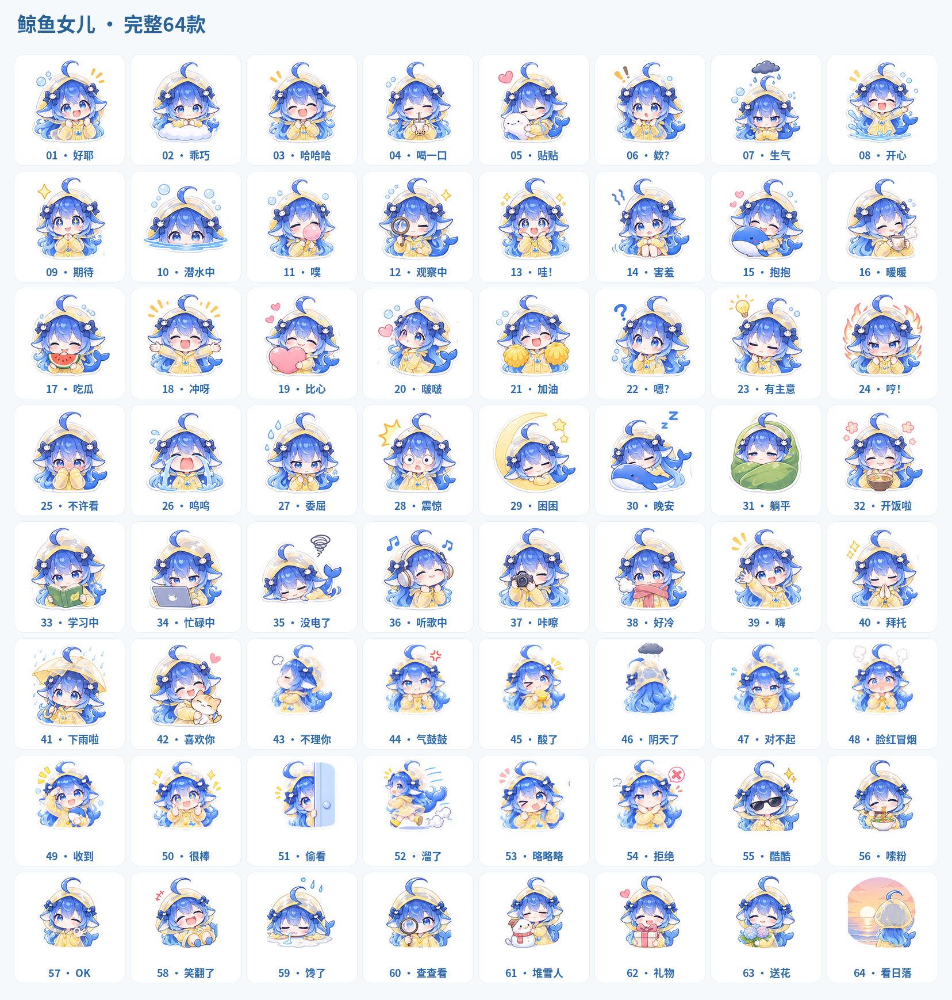

# 鲸鲸表情包 · 64 款

我女儿「鲸鲸」（源之大肥鱼）的专属 Q 版表情包。



- **角色**：Q 版蓝色小鲸鱼娘，蓝发 + 鲸鱼鳍耳 + 鲸鱼尾巴 + 透明黄色雨衣
- **规格**：512×512 PNG，透明背景，64 张
- **两套**：带文字 / 无文字，构图完全一致，按需取用
- **风格**：马卡龙浅蓝 + 奶油黄，干净线条，柔和阴影

## 目录

```
stickers/
  with-text/     带文字版（64 张，图下方有配字）
  no-text/       无文字版（64 张，只有角色）
titles.tsv       文件名 <Tab> 配字
preview.png      全览图
docs/
  角色卡.md       角色外观锚点（补图时必读）
  提示词模板.md    生成方法
```

## 使用

**微信**：手机微信 → 我 → 表情 → 添加的单个表情 → 从相册添加。
**QQ**：聊天输入框 → 表情 → 设置 → 添加。

**给 AI 用**（比如聊天机器人）：用 `no-text/` 这一套，文件名就是语义标签，直接按名字调用。

## 命名规则

`<序号>_<配字>.png`，例如 `01_好耶.png`、`32_开饭啦.png`。
序号从 01 到 64，配字见 `titles.tsv`。

## 许可

角色设定为个人原创，图片为 AI 辅助生成。

采用 [CC BY-NC 4.0](https://creativecommons.org/licenses/by-nc/4.0/) 许可：
- 可以免费用于个人、非商业场景
- 转载、二次使用需署名「鲸鲸表情包 · TheoJove」
- **不可商用**

风格参考了开源项目 [Ls1a/dafeiyu-stickers](https://github.com/Ls1a/dafeiyu-stickers) 的 Q 版方向，致谢。
